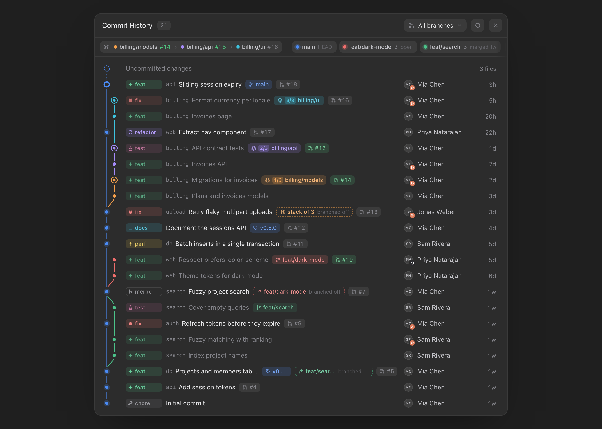
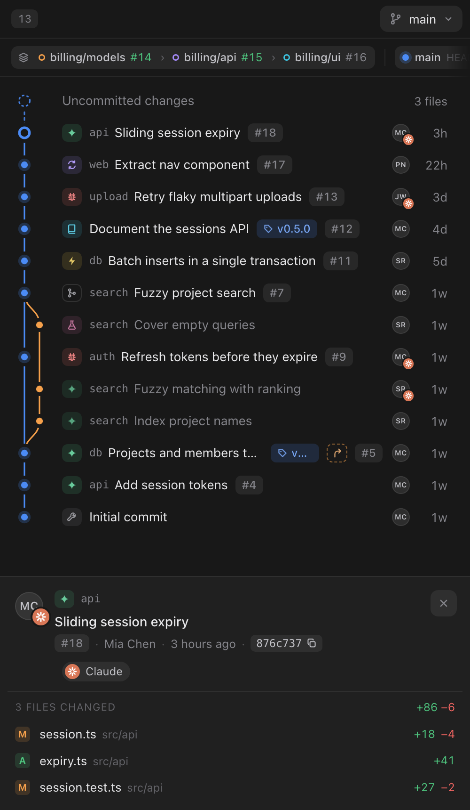

# Gistry — Commit History

**See your repository's history the way you think about it: branches, merges, stacked PRs, and who (or what) wrote each commit.**

Gistry adds a fast, good-looking commit graph to VS Code and Cursor. It reads straight from Git and needs no setup or account. It stays out of your way until you open it.

## Features

### A graph you can read at a glance

- **Branch lanes with curved merge connectors.** Every branch gets its own color, and merges and fork points curve into place.
- **HEAD is a hollow ring.** Uncommitted changes show as a dashed node at the top. Click it to jump to Source Control.
- **Side branches are dimmed.** Commits that aren't on the branch's first-parent line fade back, so the main line stands out.
- **A legend under the header lists every branch in view** with its color, commit count and status: HEAD, open, or merged (and when). Hover a branch to spotlight it from its first commit to its merge. Click it to pin the spotlight and scroll there.

### Stacked pull requests

- **Stacks are detected automatically** from [Graphite](https://graphite.dev) metadata, GitHub PR base branches, or plain branch history.
- **The stack bar shows each stack bottom to top** (`billing/models › billing/api › billing/ui`) with PR numbers. Each PR's segment of the lane gets its own color.
- **Pills mark each PR's position in its stack** (`1/3`, `2/3`, …). A warning appears when a branch **needs a restack** because its parent has moved on.

### Commits that explain themselves

- **[Conventional commits](https://www.conventionalcommits.org) get a colored type tag** (`feat`, `fix`, `perf`, `refactor`, …) with their scope. Breaking changes are flagged.
- **PR numbers come from `(#123)` suffixes and GitHub merge commits.** Merge commits show the PR title instead of "Merge pull request…".
- **AI co-author badges.** A commit with a `Co-authored-by: Claude …` trailer gets a badge on the author's avatar. Cursor, Copilot and other bots get their own.

### Details on demand

- **Hover an author** to see the hash, files changed with +/−, relative time and branch.
- **Click a commit** to open the details drawer: the full message, co-authors and changed files. Click a file to open its diff. Use <kbd>↑</kbd>/<kbd>↓</kbd> or <kbd>j</kbd>/<kbd>k</kbd> to move between commits and <kbd>Esc</kbd> to close.
- **Right-click a commit** to copy its SHA or message, create a branch from it, or check it out.

### GitHub pull requests (optional)

If you're already signed in to GitHub in your editor, Gistry shows **PR status** (open, draft, merged, closed) next to each branch and links straight to the PR. It also uses PR base branches to find stacks. Gistry never asks you to sign in unless you choose **Connect GitHub for PR status** from the branch switcher.

### Everything else

- **Switch between** the current branch, any local branch, or **all branches**. Your choice is saved per repository, and multi-root workspaces let you switch repositories.
- **Loads more history as you scroll** and refreshes when the repository changes.
- **Follows your theme** (light, dark and high contrast) and works in narrow sidebars.

## Getting started

1. Install Gistry:
   - **VS Code**: from the [Visual Studio Marketplace](https://marketplace.visualstudio.com/items?itemName=gistry.gistry), or run `code --install-extension gistry.gistry`.
   - **Cursor, VSCodium, Windsurf and other editors that use Open VSX**: search for **Gistry** in the Extensions view, or get it from [Open VSX](https://open-vsx.org/extension/gistry/gistry).
2. Open a folder that's a Git repository.
3. Click the **Gistry** icon in the Activity Bar. Or run **Gistry: Open Commit History** from the Command Palette to open the history in an editor tab.

> **Tip:** You can drag the Gistry view into the secondary sidebar to keep history next to your code.

## Commands

| Command                                 | What it does                               |
| --------------------------------------- | ------------------------------------------ |
| `Gistry: Show Commit History in Sidebar` | Opens the Gistry view in the sidebar.      |
| `Gistry: Open Commit History`           | Opens the history in a full editor tab.    |
| `Gistry: Refresh Commit History`        | Reloads every open history view.           |

## Settings

| Setting                      | Default  | Description                                                                                                                                            |
| ---------------------------- | -------- | ------------------------------------------------------------------------------------------------------------------------------------------------------ |
| `gistry.avatars`             | `remote` | `remote` loads author photos from GitHub (for noreply addresses) or Gravatar and falls back to initials. `initials` never makes network requests.      |
| `gistry.pageSize`            | `200`    | How many commits to load at a time. More load automatically as you scroll.                                                                              |
| `gistry.github.pullRequests` | `true`   | Show PR numbers, status and stacked-PR bases from GitHub. Uses your existing GitHub sign-in in the editor and never prompts unless you click **Connect GitHub**. |

## Privacy

Gistry runs `git` locally and sends no telemetry. It makes network requests only for:

- **Avatars** from GitHub or Gravatar. Turn these off with `"gistry.avatars": "initials"`.
- **Pull request data** from the GitHub API, and only when you're signed in to GitHub and the repository's remote is on github.com. Turn this off with `"gistry.github.pullRequests": false`.

## Requirements

- VS Code 1.85 or later, or Cursor or another compatible editor.
- The built-in **Git** extension must be enabled. It is by default.

## Feedback and contributing

Found a bug or have an idea? [Open an issue](https://github.com/levijubb/gistry/issues). Pull requests are welcome too. [CONTRIBUTING.md](CONTRIBUTING.md) covers the dev setup, which takes about a minute.

See the [changelog](CHANGELOG.md) for what's new in each release.

## License

[MIT](LICENSE)
