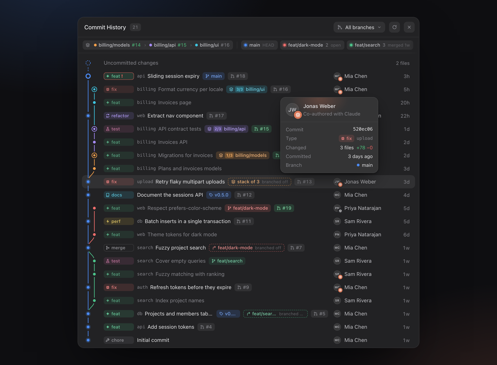
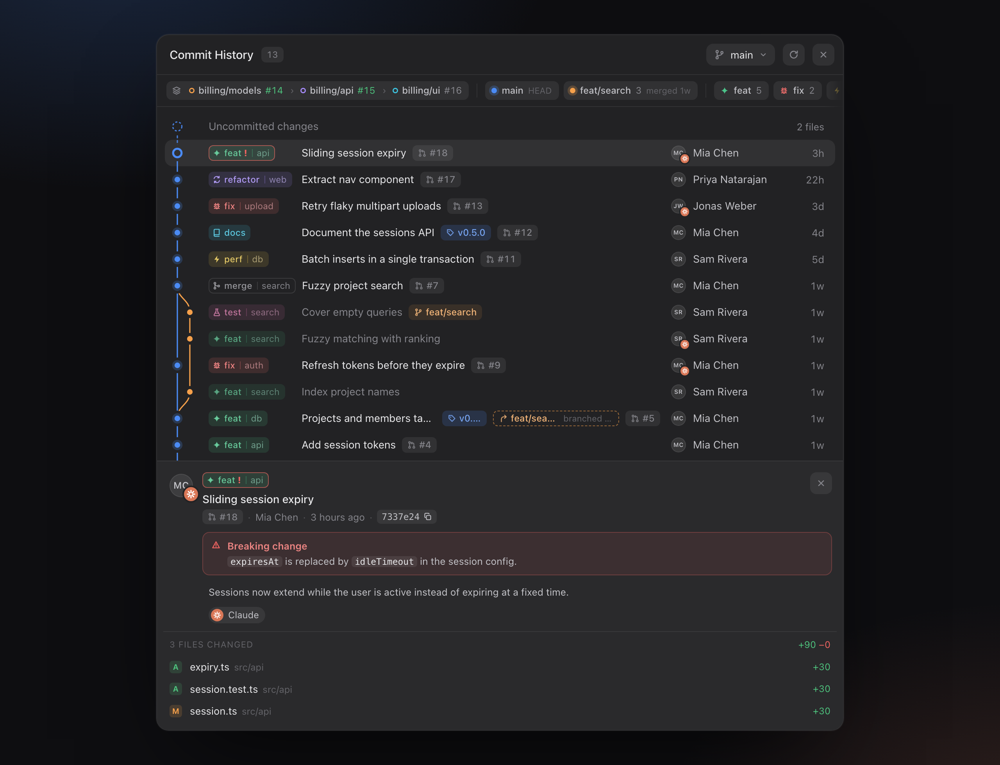

# Gistry

A commit graph for VS Code and Cursor that shows branch lanes, stacked PRs and conventional commits.

## Stacked PRs

Stacks are detected from [Graphite](https://graphite.dev) metadata, GitHub PR base branches or branch history. Each PR gets its own color along the lane and a `1/3`-style pill. The details drawer shows the whole stack with PR status, and flags branches that need a restack.

## Conventional commits

`feat(api)!: …` becomes a colored type and scope tag followed by the description. Breaking changes are outlined, with the `BREAKING CHANGE:` note shown in the drawer. `(#123)` suffixes and GitHub merge commits become clickable PR pills.

## Spotlight

Hover or click a PR, branch, commit type or scope in the legend to highlight its commits. Everything else fades back.

## Also

- **Click a commit** to see its message, co-authors and changed files. Click a file to open its diff.
- **Hover an author** for a summary card with the files changed and the branch.
- **AI co-authors** such as Claude, Cursor and Copilot get a badge on the author's avatar.
- **Right-click a commit** to copy its SHA or message, create a branch from it, or check it out.
- **Keyboard:** <kbd>↑</kbd> <kbd>↓</kbd> or <kbd>j</kbd> <kbd>k</kbd> move between commits, and <kbd>Esc</kbd> closes the drawer.
- **Works in a narrow sidebar** and in light, dark and high-contrast themes.

## Usage

Click the **Gistry** icon in the Activity Bar, or run **Gistry: Open Commit History** to open it in an editor tab. Use the branch menu to switch between the current branch, another branch, a stack or all branches.

Requires VS Code 1.85+ or a compatible editor (Cursor, VSCodium, Windsurf) with the built-in Git extension enabled.

## Settings

| Setting                      | Default  | Description                                                                                                  |
| ---------------------------- | -------- | ------------------------------------------------------------------------------------------------------------ |
| `gistry.avatars`             | `remote` | `remote` loads author photos from GitHub or Gravatar. `initials` makes no network requests.                  |
| `gistry.pageSize`            | `200`    | Commits to load at a time. More load as you scroll.                                                          |
| `gistry.github.pullRequests` | `true`   | Show PR status and stack bases from GitHub, using your existing GitHub sign-in. Never prompts on its own.    |

## Privacy

Gistry runs `git` locally and sends no telemetry. The only network requests are for avatars and, when you're signed in to GitHub, PR data for github.com repositories. Both can be turned off above.

---

Design inspired by [@kvnkld](https://x.com/kvnkld). [Report an issue](https://github.com/levijubb/gistry/issues) · [Contributing](CONTRIBUTING.md) · [MIT License](LICENSE)
