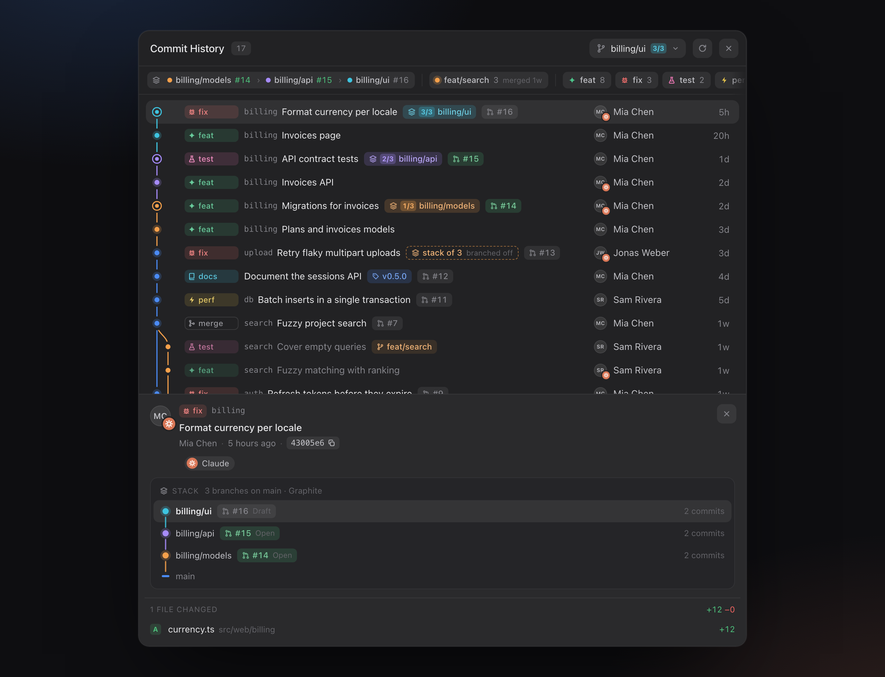
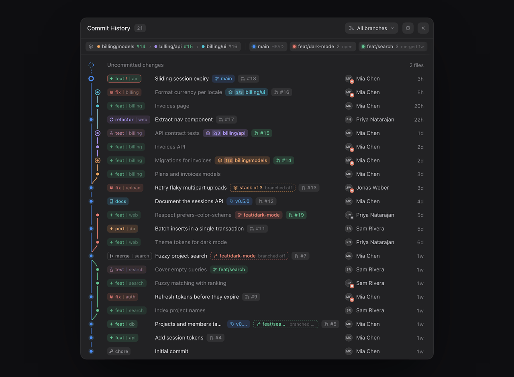

# Gistry

**Your Git history, drawn beautifully.** Branch lanes, stacked PRs and conventional commits, right inside VS Code and Cursor.

## Stacked PRs, finally visible

- **Detected automatically** from [Graphite](https://graphite.dev) metadata, GitHub PR base branches, or plain branch history. There's nothing to configure.
- **Every PR gets its own color** along the lane, with a ringed node where one PR ends and the next begins.
- **Pills show each PR's place in its stack** (`1/3`, `2/3`, `3/3`). The drawer shows the whole stack with PR status, and warns you when a branch **needs a restack**.

## Conventional commits that read like a changelog

- **`feat(api)!: …` becomes a colored type tag, a scope and a clean description.** When most of a repo's commits follow the format, the tags line up in their own column.
- **Breaking changes stand out**, with the `BREAKING CHANGE:` note shown in the drawer.
- **PR numbers become links.** `(#123)` suffixes and GitHub merge commits turn into clickable PR pills. Merge commits show the PR title instead of "Merge pull request…".

## Spotlight anything

Hover or click anything in the legend to highlight it, from where it started to where it was merged: a PR in a stack, a branch, a commit type, or a scope. Everything else fades back.

## Made for the sidebar, at home in any theme

Gistry has its own sidebar icon and adapts to narrow widths. It follows your light, dark or high-contrast theme. You can also drag it into the secondary sidebar to keep history next to your code.

## And the little things

- **Hover an author** to see the commit, its files changed with +/−, and the branch it's on.
- **AI co-author badges.** A `Co-authored-by: Claude` trailer adds a badge to the author's avatar. Cursor, Copilot and other bots get their own.
- **Click a commit** to see its message, co-authors and changed files. Click a file to open its diff.
- **Keyboard friendly:** <kbd>↑</kbd> <kbd>↓</kbd> or <kbd>j</kbd> <kbd>k</kbd> move between commits, and <kbd>Esc</kbd> closes the drawer.
- **Right-click a commit** to copy its SHA or message, create a branch from it, or check it out.
- **Switch between** the current branch, any branch, a whole stack, or all branches. Gistry remembers your choice for each repository.
- **Fast on big repos:** history loads as you scroll and refreshes when the repository changes.

## Get started

1. Install **Gistry** from the Extensions view (VS Code Marketplace or Open VSX).
2. Open a folder that contains a Git repository.
3. Click the **Gistry** icon in the Activity Bar. Or run **Gistry: Open Commit History** to open the history in an editor tab.

## Settings

| Setting                      | Default  | What it does                                                                                                                   |
| ---------------------------- | -------- | ------------------------------------------------------------------------------------------------------------------------------ |
| `gistry.avatars`             | `remote` | `remote` loads author photos from GitHub or Gravatar. `initials` never makes network requests.                                  |
| `gistry.pageSize`            | `200`    | How many commits to load at a time. More load as you scroll.                                                                    |
| `gistry.github.pullRequests` | `true`   | Show PR status and stack bases from GitHub. Uses your existing GitHub sign-in in the editor, and never prompts unless you click **Connect GitHub**. |

## Privacy

Gistry runs `git` locally and sends **no telemetry**. The only network requests are for author avatars and, if you're signed in to GitHub, pull request data for repositories hosted on github.com. You can turn off both with the settings above.

## Requirements

VS Code 1.85 or later, or Cursor, VSCodium, Windsurf or another compatible editor. The built-in Git extension must be enabled. It is by default.

---

Design inspired by [@kvnkld](https://x.com/kvnkld).

Found a bug or have an idea? [Open an issue](https://github.com/levijubb/gistry/issues). Contributions are welcome. See [CONTRIBUTING.md](CONTRIBUTING.md). Released under the [MIT License](LICENSE).
